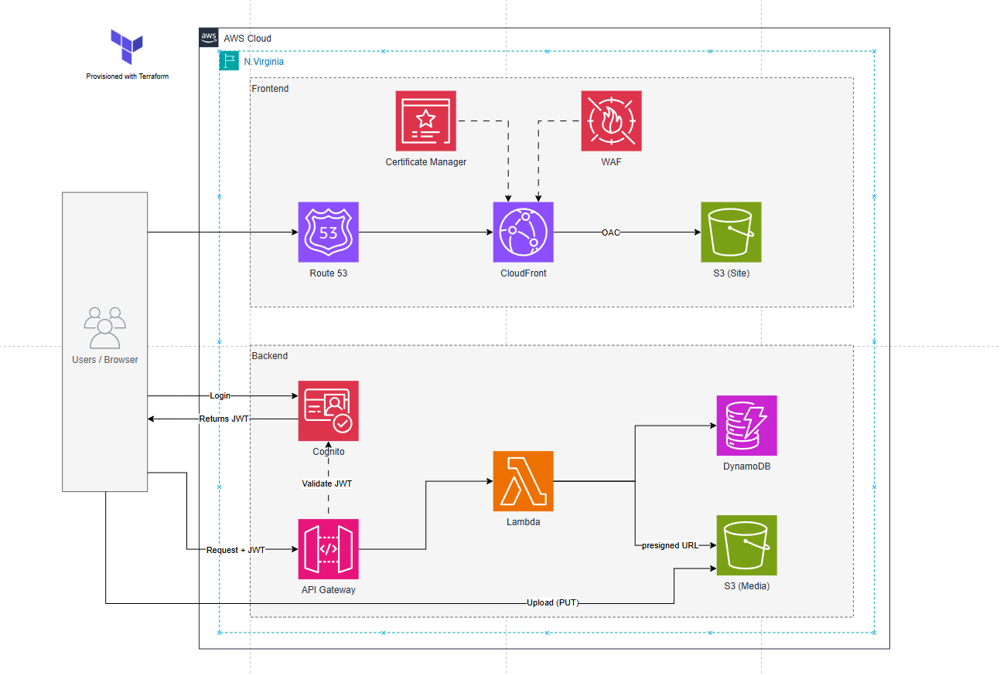

# Medium Blog — AWS Serverless com Terraform

Projeto de laboratório que implementa a infraestrutura de um blog usando serviços gerenciados da AWS e **Infrastructure as Code (IaC) com Terraform**. O objetivo principal é praticar arquitetura cloud, automação de infraestrutura, segurança, integração entre serviços e preparar a base para futuras etapas de CI/CD e hardening.

> **Status:** projeto em evolução. Este README diferencia os recursos implementados das melhorias planejadas. A infraestrutura pode gerar custos na AWS; consulte a seção [Custos e limpeza](#custos-e-limpeza).

## Objetivos

- Provisionar e gerenciar recursos AWS com Terraform.
- Publicar um frontend estático por meio de S3 privado e CloudFront.
- Configurar domínio próprio, DNS e HTTPS.
- Proteger a distribuição com AWS WAF.
- Implementar uma API HTTP com API Gateway e AWS Lambda.
- Persistir posts no Amazon DynamoDB.
- Usar Amazon Cognito para autenticação e JWT Authorizer no API Gateway.
- Permitir upload de arquivos para um bucket S3 privado usando presigned URLs.
- Criar uma base para evolução com módulos Terraform, state remoto e pipelines CI/CD.

## Arquitetura



**Observação sobre o diagrama:** o Cognito emite tokens usados pelo navegador; o API Gateway valida o JWT nas rotas protegidas. A Lambda gera uma presigned URL para o upload, e o navegador envia o arquivo diretamente ao S3. O diagrama representa a arquitetura lógica, não a localização física dos serviços.

## Serviços AWS utilizados

| Serviço | Responsabilidade |
|---|---|
| **Amazon S3 — frontend** | Armazena os arquivos estáticos do site. O acesso público direto ao bucket é bloqueado. |
| **Amazon CloudFront** | Distribui o frontend via HTTPS e usa Origin Access Control (OAC) para acessar o bucket privado. |
| **Amazon Route 53** | Hospeda a zona DNS e direciona o domínio para a distribuição CloudFront. |
| **AWS Certificate Manager (ACM)** | Fornece o certificado TLS validado por DNS para HTTPS no CloudFront. |
| **AWS WAF** | Associa uma Web ACL à distribuição CloudFront para inspeção e filtragem de requisições. |
| **Amazon API Gateway (HTTP API)** | Expõe os endpoints HTTP do backend e aplica o JWT Authorizer nas rotas protegidas. |
| **AWS Lambda** | Executa a lógica do backend, interage com DynamoDB e gera presigned URLs para upload. |
| **Amazon DynamoDB** | Armazena os dados dos posts; a tabela usa `PAY_PER_REQUEST`. |
| **Amazon Cognito** | Gerencia a autenticação e emite tokens JWT para o cliente. |
| **Amazon S3 — mídia** | Armazena arquivos enviados pelo usuário em um bucket separado e privado. |
| **Amazon CloudWatch** | Recebe logs e métricas dos componentes que foram configurados para observabilidade. |
| **AWS Budgets** | Previsto no escopo para alertas de custos; confirmar a configuração efetiva no ambiente antes de considerar concluído. |

## Fluxos principais

### 1. Acesso ao frontend

1. O usuário acessa o domínio configurado no Route 53.
2. O DNS direciona o acesso para o CloudFront.
3. O CloudFront atende os arquivos estáticos armazenados no S3 privado.
4. O OAC e a política do bucket restringem a leitura do conteúdo ao CloudFront autorizado.
5. O certificado do ACM permite servir o site por HTTPS.

### 2. Autenticação e operações da API

1. O usuário autentica-se no Cognito.
2. O Cognito retorna um JWT ao cliente.
3. O cliente envia o token no cabeçalho `Authorization: Bearer ...` ao chamar rotas protegidas.
4. O JWT Authorizer do API Gateway valida o token antes de encaminhar a requisição à Lambda.
5. A Lambda executa a operação e acessa o DynamoDB com permissões IAM.

As rotas de leitura de posts estão configuradas como públicas; as operações de criação, atualização e exclusão, assim como a solicitação de presigned URL, usam autenticação JWT. **Autenticação não equivale automaticamente à autorização por proprietário:** a validação de quem pode alterar ou excluir cada post está listada como melhoria planejada.

### 3. Upload de arquivos para S3

1. O cliente autenticado solicita uma presigned URL ao endpoint `POST /uploads/presigned-url`.
2. A Lambda gera uma URL temporária para `PutObject`, usando sua role IAM.
3. O navegador envia o arquivo diretamente ao bucket S3 por `PUT`.
4. O bucket de mídia permanece privado; a URL autoriza uma operação específica por tempo limitado.

A configuração de CORS do bucket permite o upload originado do domínio configurado. O upload foi testado via `curl` e pelo frontend. A associação do arquivo a um post e a exibição da imagem na página ainda estão pendentes.

## Infraestrutura como código — Terraform

A infraestrutura é declarada em HCL e provisionada pelo Terraform. A organização atual separa recursos por assunto em arquivos como:

- `providers.tf` e `versions.tf`: provedor AWS e requisitos de versão.
- `variables.tf`, `main.tf` e `outputs.tf`: variáveis, composição principal e saídas.
- `lambda.tf` e `iam.tf`: função Lambda, pacote de código, role e políticas IAM (ajuste os nomes conforme a estrutura real do repositório).
- `api_gateway.tf`: API HTTP, integrações, rotas, stage, CORS e autorização JWT.
- `dynamodb.tf`: tabela de posts.
- `cognito.tf`: User Pool e App Client.
- `media.tf`: bucket S3 de mídia, bloqueio de acesso público, versionamento e CORS.
- Arquivos adicionais podem conter recursos de S3 frontend, CloudFront, Route 53, ACM e WAF.

> Os nomes acima refletem a organização esperada no projeto. Antes de publicar, confira se os arquivos existem com esses nomes e atualize a lista para corresponder exatamente ao repositório.

### Decisões de infraestrutura relevantes

- **S3 privado + CloudFront OAC:** evita habilitar leitura pública direta do bucket do frontend.
- **Bucket de mídia separado:** isola os objetos enviados pelos usuários dos arquivos do site.
- **Presigned URL:** evita transferir o arquivo pela Lambda/API e não exige distribuir credenciais AWS ao navegador.
- **IAM de menor privilégio como objetivo:** a role da Lambda recebe permissões para os serviços de que precisa; revise ações e ARNs antes de uso em produção.
- **DynamoDB `PAY_PER_REQUEST`:** simplifica o laboratório sem provisionar capacidade fixa.
- **Serviços gerenciados/serverless:** não foi criada VPC apenas para esses componentes. Uma VPC seria considerada se a Lambda precisasse acessar recursos privados, como um banco relacional ou serviços internos em subnets.
- **CORS explícito:** API e bucket de mídia permitem as origens/métodos necessários ao frontend. CORS é uma política aplicada pelos navegadores, não um mecanismo de autenticação.
- **CloudFront e HTTPS:** centralizam a entrega do frontend com certificado TLS e domínio próprio.

## Estado atual e validações

### Implementado e testado

- [x] Infraestrutura base gerenciada por Terraform.
- [x] Bucket S3 privado para o frontend e bloqueio de acesso público.
- [x] CloudFront com OAC para leitura do frontend.
- [x] Domínio no Route 53, certificado ACM validado por DNS e HTTPS.
- [x] AWS WAF associado à distribuição CloudFront.
- [x] API Gateway HTTP API integrado à Lambda.
- [x] Rotas de leitura e CRUD de posts integradas ao DynamoDB.
- [x] Cognito e JWT Authorizer nas rotas protegidas.
- [x] CORS da API configurado para a origem do site.
- [x] Bucket privado de mídia, versionamento e CORS para upload.
- [x] Geração de presigned URL pela Lambda.
- [x] Upload de arquivo testado com `curl` e pelo navegador.

### Pendente ou a revisar

- [ ] Finalizar testes do WAF e configurar/testar rate limiting.
- [ ] Confirmar a configuração de AWS Budgets e alertas de custo.
- [ ] Associar a chave da imagem (`imageKey`) ao post no DynamoDB e exibir a imagem.
- [ ] Definir o fluxo de leitura de mídia (por exemplo, presigned GET ou distribuição CloudFront dedicada).
- [ ] Garantir autorização por proprietário para edição e exclusão de posts.
- [ ] Revisar validação de entradas, tipos/tamanhos de arquivo e nomes de objetos.
- [ ] Adotar módulos Terraform.
- [ ] Configurar backend remoto do Terraform e controle de concorrência.
- [ ] Implementar CI/CD com GitHub Actions e OIDC.
- [ ] Fazer hardening de IAM, logs, segredos e configurações de segurança.
- [ ] Revisar tratamento de erros, paginação e consultas do DynamoDB.

## Como executar o Terraform

> Execute os comandos a partir do diretório `terraform/`. Confirme a conta AWS, a região e o estado atual antes de aplicar mudanças.

### Pré-requisitos

- Conta AWS com permissões adequadas para os recursos do projeto.
- AWS CLI instalada e credenciais configuradas localmente.
- Terraform instalado.
- Node.js/npm, caso seja necessário instalar dependências ou empacotar a Lambda.
- Domínio próprio, caso deseje reproduzir a configuração de Route 53/ACM/CloudFront.
- Verificação dos nomes globais de buckets e de quaisquer recursos dependentes.

### Validar e planejar

```bash
cd terraform
terraform init
terraform fmt -recursive
terraform validate
terraform plan
```

Revise o plano cuidadosamente. Em especial, confira se o Terraform propõe destruir ou recriar recursos existentes antes de continuar.

### Aplicar

```bash
terraform apply
```

Confirme a operação somente após revisar as alterações planejadas. Para ambientes existentes, mantenha backup e controle do state antes de refatorar recursos ou migrá-los para módulos.

### Atualizar o frontend

Os arquivos do site são publicados no S3 pelo Terraform. Depois de alterar arquivos estáticos, rode `terraform plan` e `terraform apply` e, se necessário, invalide o cache do CloudFront. Use o ID real da distribuição obtido no ambiente — não armazene IDs ou valores de ambiente como se fossem universais.

## Próximas etapas

1. Concluir testes do WAF e rate limiting.
2. Revisar IAM, logs e controles de segurança.
3. Associar e apresentar imagens nos posts.
4. Reorganizar a infraestrutura em módulos Terraform reutilizáveis.
5. Migrar o state para backend remoto com controle de concorrência e proteção adequada.
6. Automatizar validação e implantação com GitHub Actions usando OIDC, evitando chaves AWS estáticas no pipeline.
7. Implementar pipelines de frontend e backend.
8. Revisar autorização por proprietário, paginação, validação de arquivos e demais melhorias da aplicação.

## Aprendizados demonstrados

- Modelagem e provisionamento de infraestrutura com Terraform.
- Integração entre serviços AWS gerenciados.
- Entrega de conteúdo estático por CloudFront com origem S3 privada.
- DNS e HTTPS com Route 53 e ACM.
- Proteção de aplicações web com AWS WAF.
- Autenticação com Cognito e validação JWT no API Gateway.
- Backend serverless com Lambda e DynamoDB.
- Upload direto ao S3 com presigned URLs e permissões IAM.
- Testes de integração e troubleshooting de CORS, rotas e permissões.

---

**Projeto de laboratório para estudo de Cloud / DevOps / SRE.** A infraestrutura continua em evolução.
